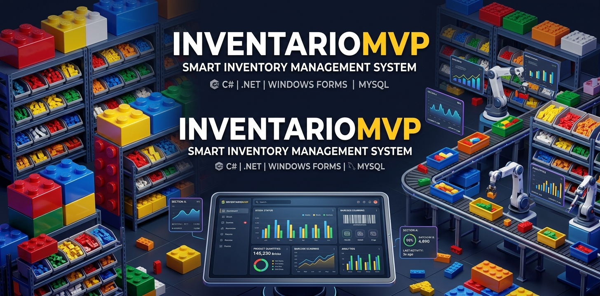
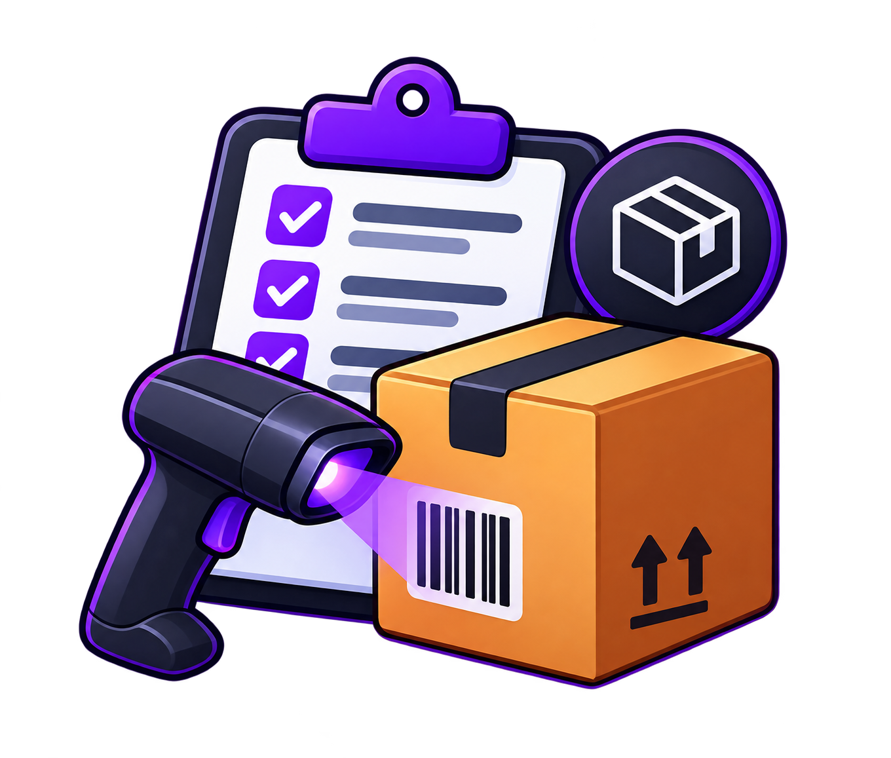
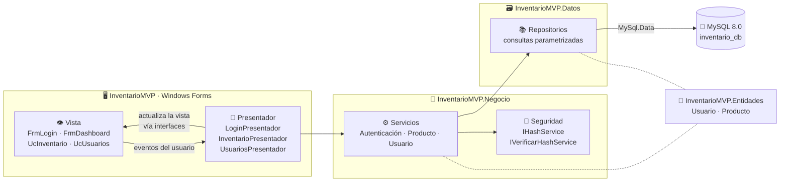
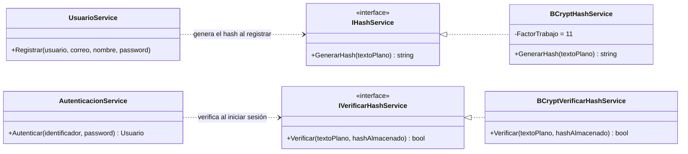
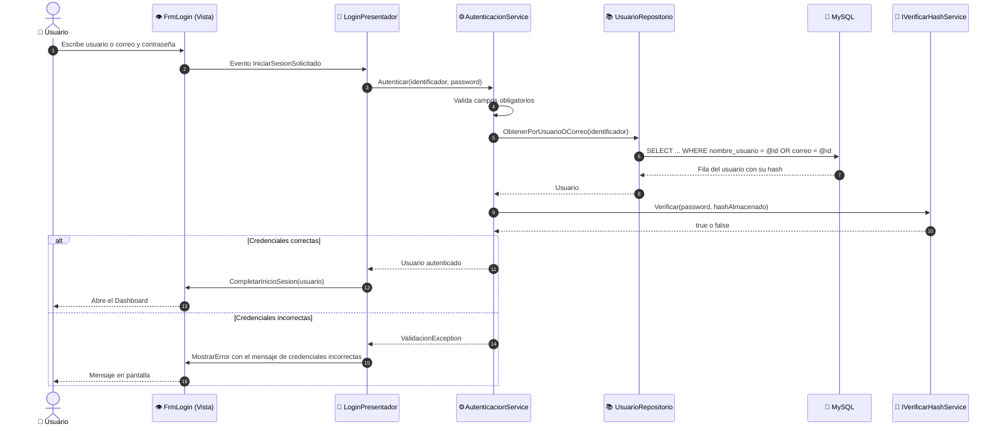
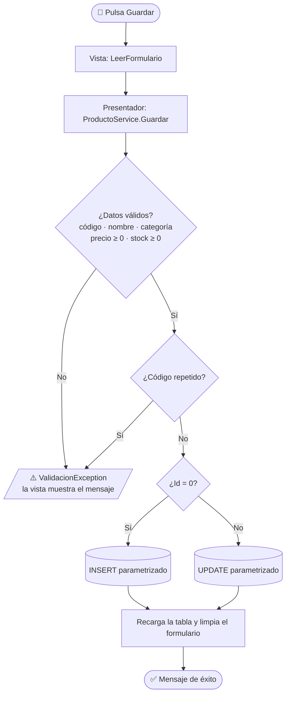
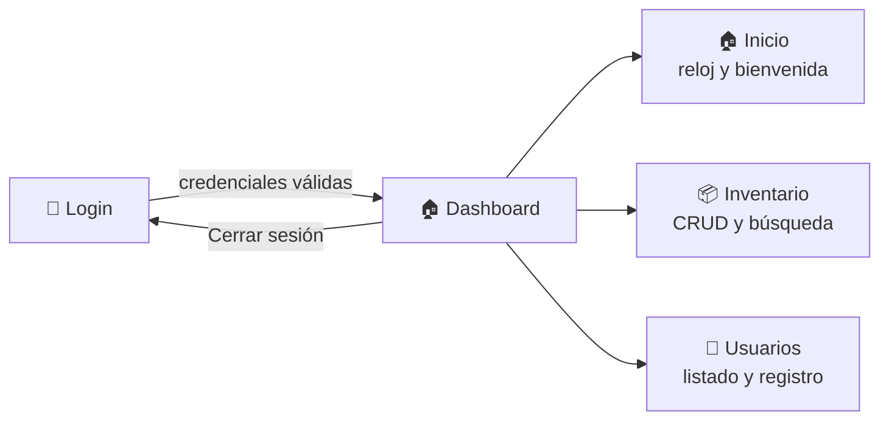
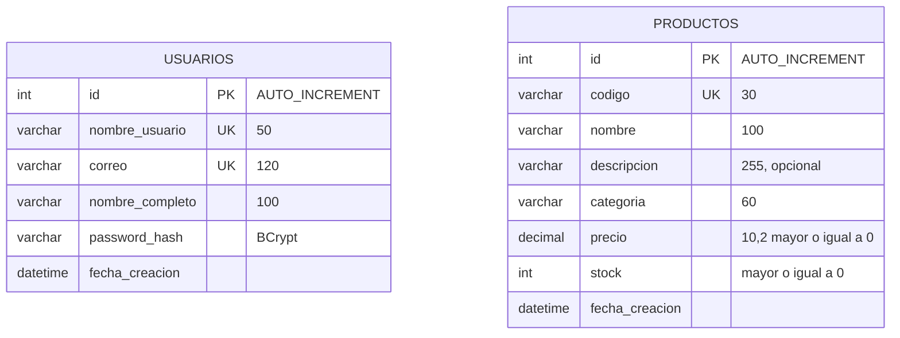

<div align="center">





# 📦 InventarioMVP

### Sistema inteligente de gestión de inventario · Escritorio · Arquitectura MVP en capas


<br/>


</div>

---

## 📑 Tabla de contenido

- [✨ Descripción](#-descripción)
- [🚀 Funcionalidades](#-funcionalidades)
- [🧰 Tecnologías utilizadas](#-tecnologías-utilizadas)
- [🗂️ Distribución del proyecto](#️-distribución-del-proyecto)
- [🏛️ Arquitectura MVP en capas](#️-arquitectura-mvp-en-capas)
- [🔐 Seguridad](#-seguridad)
- [🔄 Flujos](#-flujos)
- [🗄️ Base de datos](#️-base-de-datos)
- [⚙️ Instalación](#️-instalación)
- [📸 Capturas de pantalla](#-capturas-de-pantalla)
- [🎛️ Controles utilizados](#️-controles-utilizados)
- [🎨 Iconografía e identidad visual](#-iconografía-e-identidad-visual)
- [🧪 Pruebas realizadas](#-pruebas-realizadas)
- [🏁 Conclusiones](#-conclusiones)
- [👤 Autor](#-autor)

---

## ✨ Descripción

**InventarioMVP** es una aplicación de escritorio para **gestionar el inventario** de un negocio: registrar, editar, eliminar y buscar productos, administrar los usuarios del sistema y entrar de forma segura con una autenticación real contra **MySQL**.

Fue desarrollada como laboratorio del curso **Herramientas de la Programación Aplicada III (.NET)** y su objetivo principal es demostrar una **separación limpia de responsabilidades** mediante el patrón **MVP** (Modelo · Vista · Presentador) en cuatro capas independientes.

> 💡 La interfaz **no sabe** qué es un hash ni toca la base de datos; el presentador **no conoce** controles de Windows Forms; y la capa de datos **no tiene** reglas de negocio.

---

## 🚀 Funcionalidades

| | Módulo | Detalle |
|---|---|---|
| 🔑 | **Login** | Acceso con **usuario o correo** + contraseña, con validaciones. Autenticación real contra MySQL comparando el hash BCrypt. El mensaje de error es genérico para no revelar si el usuario existe. |
| 🏠 | **Dashboard** | Menú lateral izquierdo (Inicio, Inventario, Usuarios, Cerrar sesión), **fecha y hora en vivo** y el **usuario autenticado** visible en la parte inferior del menú y en la esquina superior derecha. |
| 📦 | **Inventario** | `DataGridView` con código, nombre, descripción, categoría, precio y stock. **Registrar, editar, eliminar** (con confirmación) y **buscar**. |
| 👥 | **Usuarios** | Listado y registro de nuevos usuarios; la contraseña se guarda **únicamente como hash BCrypt**. |
| 🛡️ | **Privilegios mínimos** | La aplicación usa un usuario de MySQL propio con solo los permisos indispensables (nunca `root`). |

### ✅ Reglas de validación

| Campo | Regla |
|---|---|
| 📦 Producto | Código, nombre y categoría obligatorios · código **único** · precio ≥ 0 · stock ≥ 0 |
| 👤 Usuario | 3-50 caracteres sin espacios ni `@` · correo válido · contraseña ≥ 8 caracteres con confirmación · usuario y correo **únicos** |
| 🔑 Login | Usuario/correo y contraseña obligatorios |

---

## 🧰 Tecnologías utilizadas

<div align="center">

| Tecnología | Versión | Para qué se usa |
|:---:|:---:|---|
|  | **10.0** (SDK 10.0.403) | Plataforma de ejecución |
|  | **14** | Lenguaje |
|  | `net10.0-windows` | Interfaz de escritorio |
|  | **8.0** | Base de datos |
|  | **26.10.0** | Conector ADO.NET a MySQL |
|  | **4.2.0** | Generación y verificación de hashes |
|  | **3.4.7** | Renderizado de los iconos SVG |
|  | última | Colección de iconos *outline* |
|  | **2026** | IDE |
|   | — | Control de versiones y repositorio |

</div>

---

## 🗂️ Distribución del proyecto

La solución (`InventarioMVP.slnx`) está formada por **4 proyectos**, uno por capa:

```text
📁 InventarioMVP/
├── 📄 InventarioMVP.slnx
├── 📄 README.md
├── 📄 .gitignore
│
├── 📁 BaseDatos/
│   └── 📜 instalacion.sql              ← BD, tablas, usuario con privilegios mínimos y admin inicial
│
├── 📁 docs/img/                         ← banner, logo original y capturas del README
│
├── 🟦 InventarioMVP.Entidades/          ← MODELO: clases puras
│   ├── Usuarios.cs                      (Usuario)
│   └── Productos.cs                     (Producto)
│
├── 🟩 InventarioMVP.Datos/              ← ACCESO A DATOS
│   ├── ConexionmYSQL.cs                 (ConexionMySql)
│   └── Repositorios/
│       ├── IUsuarioRepositorio.cs · UsuarioRepositorio.cs
│       └── IProductoRepositorio.cs · ProductoRepositorio.cs
│
├── 🟨 InventarioMVP.Negocio/            ← LÓGICA DE NEGOCIO
│   ├── Seguridad/
│   │   ├── IHashService.cs              (solo GENERA hashes)
│   │   ├── IVerificarHashService.cs     (solo VERIFICA hashes)
│   │   ├── BCryptHashService.cs
│   │   └── BCryptVerificarHashService.cs
│   └── Servicios/
│       ├── AutenticacionService.cs
│       ├── ProductoService.cs
│       ├── UsuarioService.cs
│       └── ValidacionException.cs
│
└── 🟪 InventarioMVP/                    ← VISTA + PRESENTADOR (Windows Forms)
    ├── Program.cs                       (raíz de composición)
    ├── appsettings.example.json         (plantilla; el appsettings.json real está en .gitignore)
    ├── Presentadores/
    │   ├── LoginPresentador.cs
    │   ├── InventarioPresentador.cs
    │   └── UsuariosPresentador.cs
    ├── Vistas/
    │   ├── ILoginView.cs · IInventarioView.cs · IUsuariosView.cs   (contratos de vista)
    │   ├── FrmLogin.cs · FrmDashboard.cs
    │   ├── UcInicio.cs · UcInventario.cs · UcUsuarios.cs
    │   └── PerfilUsuarioControl.cs · Estilos.cs · Iconos.cs · Imagenes.cs
    └── Resources/
        ├── Icons/                       (SVG Lucide + licencia)
        └── Images/                      (logo.png y app.ico incrustados)
```

| Capa | Proyecto | Responsabilidad | Depende de |
|:---:|---|---|---|
| 🟪 Vista + Presentador | `InventarioMVP` | Mostrar datos, capturar eventos, coordinar | Negocio, Entidades, Datos* |
| 🟨 Negocio | `InventarioMVP.Negocio` | Reglas, validaciones y seguridad | Datos, Entidades |
| 🟩 Datos | `InventarioMVP.Datos` | Conexión y consultas parametrizadas | Entidades |
| 🟦 Entidades | `InventarioMVP.Entidades` | Clases de datos | — |

<sub>\* Solo `Program.cs` (raíz de composición) referencia Datos para ensamblar las dependencias.</sub>

---

## 🏛️ Arquitectura MVP en capas



**Ventajas aplicadas:** separación de responsabilidades · presentadores probables sin interfaz gráfica · cambio de algoritmo de hash sin tocar Vista, Presentador ni Datos · escalabilidad.

---

## 🔐 Seguridad

Dos contratos **independientes** en la capa de Negocio, con responsabilidad única cada uno:



| Medida | Cómo se aplica |
|---|---|
| 🔒 Contraseñas | Solo se almacena el **hash BCrypt** (factor 11, sal incluida) |
| 🛡️ Inyección SQL | **Todas** las consultas usan parámetros (`@param`); el `LIKE` de la búsqueda escapa `%` y `_` |
| 👤 Privilegios mínimos | Usuario `inventario_app` con `SELECT, INSERT` en `usuarios` y `SELECT, INSERT, UPDATE, DELETE` en `productos` |
| 🕵️ Login | Mismo mensaje ante usuario inexistente o contraseña incorrecta |

---

## 🔄 Flujos

### 🔑 Inicio de sesión



### 📦 Guardar un producto



### 🧭 Navegación de la aplicación



---

## 🗄️ Base de datos



El script [`BaseDatos/instalacion.sql`](BaseDatos/instalacion.sql) crea la base `inventario_db`, las dos tablas (con restricciones `UNIQUE` y `CHECK`), el usuario de MySQL con privilegios mínimos y el usuario inicial del sistema. Usa `IF NOT EXISTS`, por lo que **no borra datos existentes**.

---

## ⚙️ Instalación

### 📋 Requisitos

- 🪟 Windows 10/11
- 🟣 [Visual Studio 2026](https://visualstudio.microsoft.com/) con la carga de trabajo *Desarrollo de escritorio con .NET* (o el [SDK de .NET 10](https://dotnet.microsoft.com/download))
- 🐬 [MySQL Server 8.0](https://dev.mysql.com/downloads/mysql/) en ejecución

### 🪜 Pasos

**1️⃣ Clonar el repositorio**

```bash
git clone https://github.com/<tu-usuario>/InventarioMVP.git
cd InventarioMVP
```

**2️⃣ Crear la base de datos** (como administrador de MySQL, por ejemplo `root`)

Primero abra `BaseDatos/instalacion.sql` y reemplace `CAMBIAR_POR_SU_CLAVE` por una contraseña propia y segura para el usuario `inventario_app`. Luego ejecute:

```bash
mysql -u root -p < BaseDatos/instalacion.sql
```

> También puede abrir `BaseDatos/instalacion.sql` en **MySQL Workbench** y ejecutarlo completo.

**3️⃣ Crear su archivo de configuración local**

Copie `InventarioMVP/appsettings.example.json` como `InventarioMVP/appsettings.json` (este archivo está en el `.gitignore` y nunca se sube al repositorio) y escriba la **misma contraseña** del paso anterior:

```json
{
  "ConnectionStrings": {
    "MySql": "Server=localhost;Port=3306;Database=inventario_db;Uid=inventario_app;Pwd=SU_CLAVE;SslMode=Preferred;"
  }
}
```

**4️⃣ Compilar y ejecutar**

```bash
dotnet build
dotnet run --project InventarioMVP/InventarioMVP.csproj
```

O abra `InventarioMVP.slnx` en Visual Studio y presione **F5**.

### 🔑 Acceso inicial

| Usuario | Correo | Contraseña |
|---|---|---|
| `admin` | `admin@inventario.local` | `Admin123!` |

> ⚠️ Solo se guarda el **hash**. `admin` / `Admin123!` es una credencial **de demostración**: cámbiela (registre su propio usuario) antes de usar el sistema fuera de un entorno de pruebas. La contraseña de MySQL de `inventario_app` y el archivo `appsettings.json` real **no** forman parte del repositorio.

---

## 📸 Capturas de pantalla

> Las imágenes se cargan automáticamente desde la carpeta [`docs/img/`](docs/img/). Basta con guardar cada captura con el **nombre exacto** indicado.

### 🔑 Login y validaciones

| Pantalla de login | Validación de credenciales |
|:---:|:---:|
|  |  |
| `login.png` | `login-error.png` |

### 🏠 Dashboard (menú lateral, hora y usuario)


<sub>`inicio.png`</sub>

### 📦 Inventario

| Tabla de productos | Validaciones del formulario |
|:---:|:---:|
|  |  |
| `inventario.png` | `inventario-validaciones.png` |

### 👥 Usuarios


<sub>`usuarios.png`</sub>

### 🐬 Base de datos

| Tablas en MySQL Workbench | Hash BCrypt almacenado | Privilegios mínimos (`SHOW GRANTS`) |
|:---:|:---:|:---:|
|  |  |  |
| `mysql-tablas.png` | `mysql-hash.png` | `mysql-privilegios.png` |

### 🗂️ Estructura de la solución


<sub>`estructura-solucion.png` (Explorador de soluciones de Visual Studio)</sub>

---

## 🎛️ Controles utilizados

| Control | Uso en la aplicación |
|---|---|
| `Form` | Ventanas de login y Dashboard |
| `UserControl` | Pantallas de Inicio, Inventario y Usuarios dentro del Dashboard |
| `Panel` · `FlowLayoutPanel` · `TableLayoutPanel` | Distribución del menú, barras y formularios |
| `Label` · `TextBox` · `NumericUpDown` | Datos de entrada y textos (`UseSystemPasswordChar` en contraseñas) |
| `Button` | Acciones con icono (buscar, guardar, eliminar…) |
| `DataGridView` | Tablas de productos y usuarios |
| `PictureBox` | Logo e iconos |
| `Timer` | Reloj actualizado cada segundo |
| `MessageBox` | Avisos y confirmaciones |
| Control propio `PerfilUsuarioControl` | Perfil discreto (icono en círculo + nombre) en la esquina superior derecha |

---

## 🎨 Iconografía e identidad visual

- 🖼️ **Logo** de la aplicación en el login, el menú lateral, la pantalla de inicio y como **icono de todas las ventanas** y del ejecutable (`app.ico` con 7 tamaños, de 16 a 256 px).
- ✏️ Iconos **[Lucide](https://lucide.dev/icons/)** en estilo *outline* (licencia ISC, copia en `Resources/Icons/LICENSE.txt`), de 20 px y trazo discreto: gris neutro en el menú, blanco sobre botones y sobre la opción activa (color de acento).
- 📦 Los SVG originales y las imágenes están **incrustados en el ejecutable**; no se carga ningún archivo externo en tiempo de ejecución. `Vistas/Iconos.cs` rasteriza los SVG con **Svg.NET** al color y tamaño necesarios.

| Icono | Uso |
|---|---|
| `layout-dashboard` `package` `users` `log-out` | Menú lateral |
| `clock` · `user-round` | Fecha y hora · perfil del usuario |
| `search` `list` `plus` `save` `trash` | Acciones del inventario |
| `user-plus` · `log-in` | Registrar usuario · iniciar sesión |

---

## 🧪 Pruebas realizadas

Se verificó la capa de negocio y de datos **contra el MySQL real** (sin datos simulados) con 16 pruebas de integración:

| Área | Casos comprobados |
|---|---|
| 🔑 Login | Acceso con usuario y con correo · contraseña incorrecta · usuario inexistente · campos vacíos · intento de **inyección SQL** (`' OR '1'='1`) |
| 👥 Usuarios | Correo inválido · contraseña corta · usuario duplicado |
| 📦 Productos | Insertar · buscar · buscar con `%` · editar · eliminar · código duplicado · precio negativo |
| 🛡️ Privilegios | `SHOW GRANTS` confirma solo los permisos previstos para `inventario_app` |

<sub>Las pruebas se ejecutaron con un proyecto temporal y no forman parte del repositorio.</sub>

---

## 🏁 Conclusiones

1. 🧩 **El patrón MVP en capas mantiene el código ordenado y mantenible.** Al aislar Vista, Presentador, Negocio, Datos y Entidades, cada cambio queda acotado: modificar la interfaz no toca la lógica, y cambiar de algoritmo de hash solo implica reemplazar dos clases.
2. 🔐 **Dos interfaces separadas (`IHashService` e `IVerificarHashService`) aplican el principio de responsabilidad única.** Generar un hash y verificarlo son acciones distintas; quien registra usuarios no necesita poder verificar, y quien inicia sesión no necesita poder generar.
3. 🛡️ **La seguridad se construye por capas:** contraseñas con BCrypt, consultas parametrizadas contra la inyección SQL y un usuario de base de datos con privilegios mínimos, de modo que un fallo en la aplicación tenga un impacto limitado.
4. 🎨 **La experiencia de usuario importa.** Un menú lateral claro, iconografía consistente, el logo en todas las pantallas y mensajes de validación comprensibles hacen que una aplicación académica se sienta profesional.
5. 🧪 **Probar contra la base de datos real descubre errores que los datos simulados ocultan**, como la contraseña de root faltante, los privilegios o el escape del `LIKE`.
6. 📚 **Aprendizajes técnicos:** inyección de dependencias manual en una raíz de composición, interfaces de vista para desacoplar los presentadores de Windows Forms, y los detalles del escalado en pantallas de alta resolución.

**Posibles mejoras futuras:** reportes y gráficos de stock, roles y permisos por usuario, edición y baja de usuarios, pruebas unitarias de los presentadores y exportación a Excel/PDF.

---

## 👤 Autor

<div align="center">

### **Victor David Montes**

🎓 Universidad Tecnológica de Panamá · Facultad de Ingeniería en Sistemas Computacionales
📚 Herramientas de la Programación Aplicada III (.NET) · Grupo **1IL133**
👩‍🏫 Instructora: Ing. Irina Fong
📅 **8 de noviembre de 2026**


<sub>Hecho con 💜 y mucho café · iconos por <a href="https://lucide.dev">Lucide</a> (ISC)</sub>

</div>
