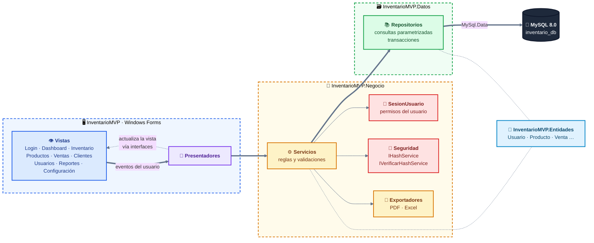
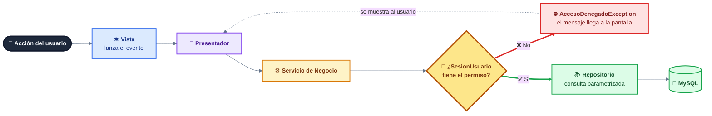
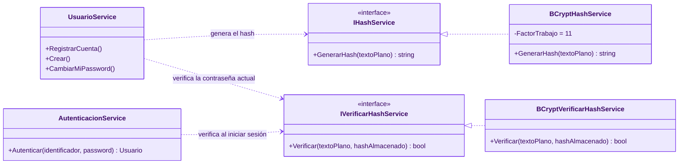
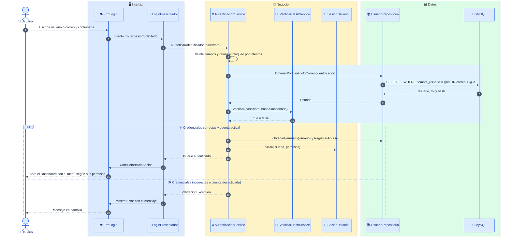
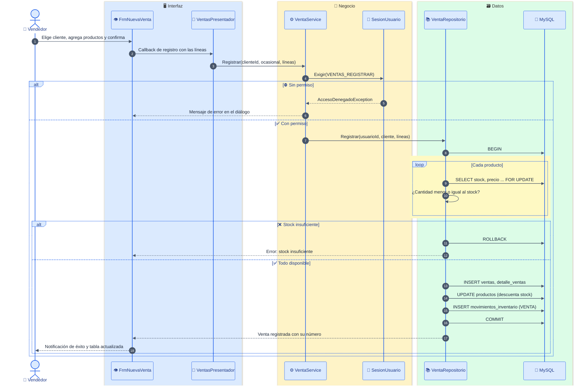
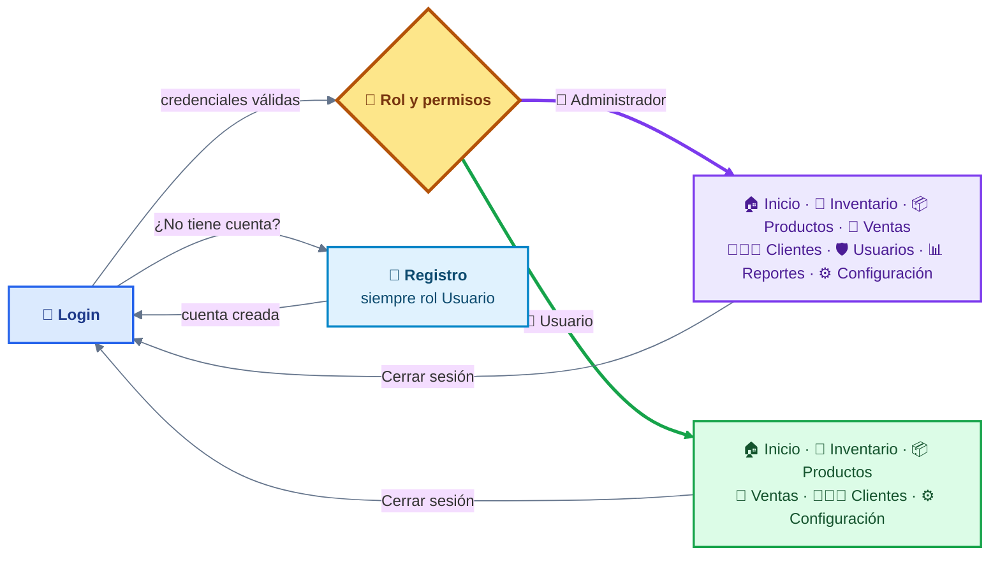
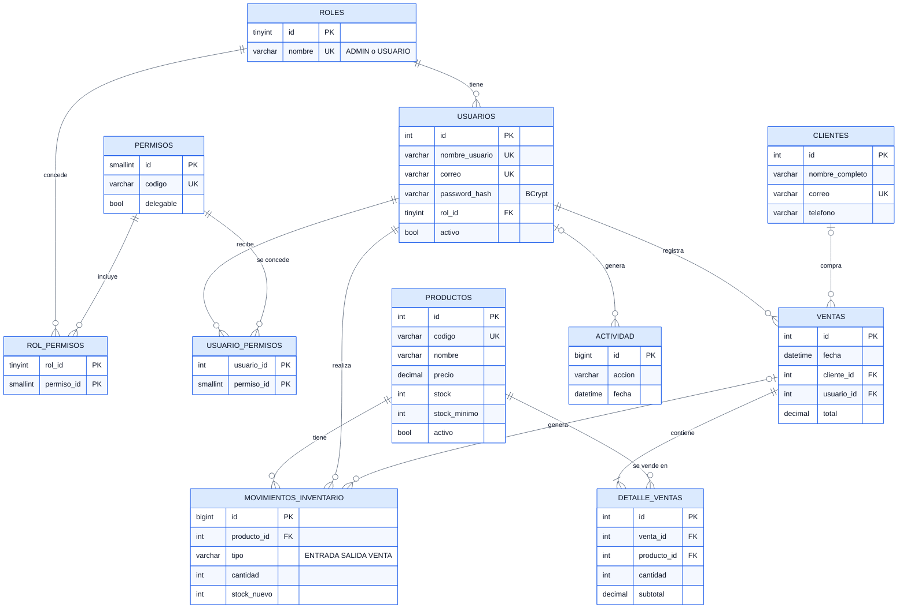
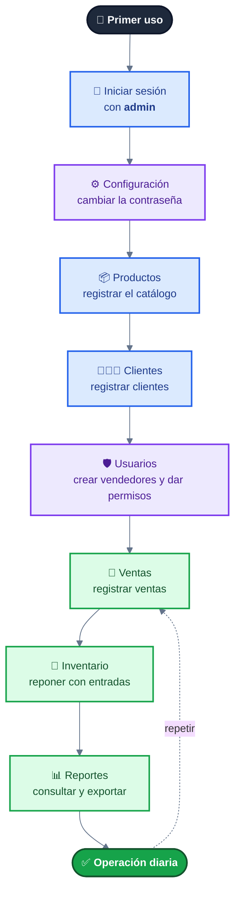

<div align="center">


# 📦 InventarioMVP

### Plataforma de gestión de inventario, clientes y ventas · Escritorio · MVP en capas · Roles y permisos


<br/>


</div>

---

## 📑 Tabla de contenido

- [✨ Descripción](#-descripción)
- [🚀 Funcionalidades](#-funcionalidades)
- [👥 Roles y permisos](#-roles-y-permisos)
- [🧰 Tecnologías utilizadas](#-tecnologías-utilizadas)
- [🗂️ Distribución del proyecto](#️-distribución-del-proyecto)
- [🏛️ Arquitectura MVP en capas](#️-arquitectura-mvp-en-capas)
- [🔐 Seguridad](#-seguridad)
- [🔄 Flujos](#-flujos)
- [🗄️ Base de datos](#️-base-de-datos)
- [⚙️ Instalación](#️-instalación)
- [📘 Guía de uso paso a paso](#-guía-de-uso-paso-a-paso)
- [📸 Capturas de pantalla](#-capturas-de-pantalla)
- [🎛️ Controles utilizados](#️-controles-utilizados)
- [🎨 Iconografía e identidad visual](#-iconografía-e-identidad-visual)
- [🧪 Pruebas realizadas](#-pruebas-realizadas)
- [🏁 Conclusiones](#-conclusiones)
- [👤 Autor](#-autor)

---

## ✨ Descripción

**InventarioMVP** es una aplicación de escritorio que funciona como una **pequeña plataforma empresarial**: gestiona **inventario, productos, clientes, ventas y usuarios**, con un **dashboard estadístico**, **reportes exportables** y un sistema de **roles y permisos (RBAC)**. Toda la información proviene de **MySQL**; no hay datos simulados.

Se desarrolló en el curso **Herramientas de la Programación Aplicada III (.NET)** y demuestra una **separación limpia de responsabilidades** con el patrón **MVP** (Modelo · Vista · Presentador) en cuatro capas independientes.

> 💡 La interfaz **no sabe** qué es un hash ni toca la base de datos; el presentador **no conoce** controles de Windows Forms; y **cada permiso se valida en la capa de Negocio**, no solo ocultando botones.

---

## 🚀 Funcionalidades

| | Módulo | Detalle |
|---|---|---|
| 🔑 | **Login y registro** | Acceso con **usuario o correo**; botón de **ojo** para mostrar u ocultar la contraseña; **crear cuenta** con validación de campos, correo y contraseña segura; mensajes claros; bloqueo temporal tras 5 intentos fallidos. |
| 🏠 | **Dashboard (Inicio)** | Saludo personalizado, **rol**, **fecha y hora en tiempo real**; tarjetas de **productos**, **clientes** y **dinero ganado** (USD, por período); gráfico de ventas, últimas ventas, más vendidos, **stock bajo** y **actividad reciente**. |
| 🏬 | **Inventario** | Existencias con estado (disponible / stock bajo / agotado); **entradas y salidas** con motivo; historial de movimientos filtrable por fechas y producto. |
| 📦 | **Productos** | Catálogo: registrar, **editar**, eliminar (baja lógica) y buscar, en ventanas modales. |
| 🛒 | **Ventas** | Nueva venta con cliente registrado u **ocasional**, productos del inventario, **subtotales y total automáticos**; descuenta el stock en una **transacción**; historial con búsqueda por número, cliente o fecha y detalle de cada venta. |
| 👥 | **Clientes** | Alta, edición y búsqueda por nombre, teléfono o correo; **historial de compras**, cuánto ha comprado y su última compra. |
| 🛡️ | **Usuarios** *(solo administrador)* | Crear usuarios y administradores, editar, **activar/desactivar**, **asignar rol y permisos**, restablecer contraseñas. |
| 📊 | **Reportes** *(solo administrador)* | 11 reportes con filtro de fechas y **exportación a PDF y Excel**. |
| ⚙️ | **Configuración** | Datos personales y cambio de contraseña (todos); parámetros del sistema (administrador). |

### ✅ Reglas de validación

| Campo | Regla |
|---|---|
| 📦 Producto | Código, nombre y categoría obligatorios · código **único** · precio ≥ 0 · stock mínimo ≥ 0 |
| 👤 Usuario | Usuario de 3-50 caracteres (letras, números, `.`, `-`, `_`) · correo válido · contraseña **segura** · usuario y correo **únicos** |
| 🔒 Contraseña | Mínimo 8 caracteres con **mayúsculas, minúsculas y números** · confirmación idéntica |
| 🧑‍🤝‍🧑 Cliente | Nombre obligatorio · teléfono válido · correo válido y único (opcional) |
| 🛒 Venta | Al menos un producto · cantidades > 0 · **no se puede vender más que el stock disponible** |
| 🏬 Movimiento | Cantidad > 0 · una **salida** exige motivo y no puede superar el stock |

---

## 👥 Roles y permisos

Existen dos tipos de cuenta. El **registro público siempre crea cuentas de tipo Usuario**: un administrador solo puede crearlo otro administrador desde el módulo *Usuarios*.

| Función | 👑 Administrador | 👤 Usuario |
|---|:---:|:---:|
| Dashboard general (ingresos, gráfico, actividad) | ✅ | ➖ vista limitada con **sus** ventas |
| Consultar productos e inventario | ✅ | ✅ |
| Crear, editar y eliminar productos | ✅ | ❌ |
| Registrar entradas y salidas de inventario | ✅ | ❌ |
| Consultar clientes | ✅ | ✅ (sin totales de compra) |
| Registrar y editar clientes | ✅ | ➕ si el administrador lo concede |
| Historial y totales de compra de clientes | ✅ | ❌ |
| Registrar ventas | ✅ | ➕ si el administrador lo concede |
| Consultar ventas | ✅ todas | ✅ solo las propias |
| Reportes y exportación | ✅ | ❌ |
| Crear, editar y desactivar usuarios · asignar roles y permisos | ✅ | ❌ |
| Modificar sus datos y contraseña | ✅ | ✅ |
| Configuración administrativa | ✅ | ❌ |

Las **pestañas del menú lateral se muestran según el rol y los permisos**: un usuario normal no ve *Usuarios* ni *Reportes*.

---

## 🧰 Tecnologías utilizadas

<div align="center">

| Tecnología | Versión | Para qué se usa |
|:---:|:---:|---|
|  | **10.0** (SDK 10.0.403) | Plataforma de ejecución |
|  | **14** | Lenguaje |
|  | `net10.0-windows` | Interfaz de escritorio |
|  | **8.0** | Base de datos |
|  | **26.10.0** | Conector ADO.NET a MySQL |
|  | **4.2.0** | Generación y verificación de hashes |
|  | **0.105.1** | Exportación a Excel (.xlsx) |
|  | **2026.9.1** | Exportación a PDF |
|  | **3.4.7** | Renderizado de los iconos SVG |
|  | última | Colección de iconos *outline* |
|  | **2026** | IDE |
|   | — | Control de versiones y repositorio |

</div>

> 📄 **Licencias:** QuestPDF se usa bajo su licencia *Community* (gratuita para organizaciones pequeñas y proyectos educativos; revise sus términos para uso comercial). Lucide está bajo licencia ISC.

---

## 🗂️ Distribución del proyecto

La solución (`InventarioMVP.slnx`) está formada por **4 proyectos**, uno por capa:

```text
📁 InventarioMVP/
├── 📄 InventarioMVP.slnx
├── 📄 README.md
├── 📄 .gitignore
│
├── 📁 BaseDatos/
│   ├── 📜 instalacion.sql               ← 1.º: BD, tablas base, usuario con privilegios mínimos y admin inicial
│   └── 📜 migracion_v2.sql              ← 2.º: roles y permisos, clientes, ventas, movimientos (conserva los datos)
│
├── 📁 docs/img/                         ← banner, logo original y capturas del README
│
├── 🟦 InventarioMVP.Entidades/          ← MODELO: clases puras
│   ├── Usuarios.cs · Productos.cs · Clientes.cs
│   └── Ventas.cs · Inventario.cs · Reportes.cs
│
├── 🟩 InventarioMVP.Datos/              ← ACCESO A DATOS (consultas parametrizadas y transacciones)
│   ├── ConexionmYSQL.cs                 (ConexionMySql + Operacion: Usar / EnTransaccion)
│   └── Repositorios/
│       ├── Usuario · Producto · Cliente
│       └── Venta · Inventario · Reporte · Actividad (+ Configuración)
│
├── 🟨 InventarioMVP.Negocio/            ← LÓGICA DE NEGOCIO y REGLAS DE ACCESO
│   ├── Seguridad/
│   │   ├── IHashService.cs              (solo GENERA hashes)
│   │   ├── IVerificarHashService.cs     (solo VERIFICA hashes)
│   │   ├── BCryptHashService.cs · BCryptVerificarHashService.cs
│   │   ├── Permisos.cs                  (códigos de permiso y roles)
│   │   └── SesionUsuario.cs             (sesión en memoria + Exigir(permiso))
│   ├── Servicios/
│   │   ├── Autenticacion · Usuario · Producto · Inventario
│   │   ├── Cliente · Venta · Dashboard · Reporte · Configuracion
│   │   └── Validaciones.cs · Formato.cs · ValidacionException.cs
│   └── Reportes/Exportadores.cs         (Excel y PDF)
│
└── 🟪 InventarioMVP/                    ← VISTA + PRESENTADOR (Windows Forms)
    ├── Program.cs · FabricaVistas.cs    (raíz de composición y menú según permisos)
    ├── appsettings.example.json         (plantilla; el appsettings.json real está en .gitignore)
    ├── Presentadores/                   Login · Registro · Inicio · Inventario · Productos
    │                                    Ventas · Clientes · Usuarios · Reportes · Configuración
    ├── Vistas/
    │   ├── I…View.cs                    (contratos de vista)
    │   ├── Frm…  y  Uc…                 (ventanas, pantallas y diálogos modales)
    │   └── VistaBase · DialogoBase · Notificador · CampoPassword
    │       TarjetaEstadistica · GraficoBarras · PerfilUsuarioControl · Estilos · Iconos · Imagenes
    └── Resources/
        ├── Icons/                       (SVG Lucide + licencia)
        └── Images/                      (logo.png y app.ico incrustados)
```

| Capa | Proyecto | Responsabilidad | Depende de |
|:---:|---|---|---|
| 🟪 Vista + Presentador | `InventarioMVP` | Mostrar datos, capturar eventos, coordinar | Negocio, Entidades, Datos* |
| 🟨 Negocio | `InventarioMVP.Negocio` | Reglas, validaciones, **permisos** y seguridad | Datos, Entidades |
| 🟩 Datos | `InventarioMVP.Datos` | Conexión, consultas parametrizadas y transacciones | Entidades |
| 🟦 Entidades | `InventarioMVP.Entidades` | Clases de datos | — |

<sub>\* Solo `Program.cs` (raíz de composición) referencia Datos para ensamblar las dependencias.</sub>

---

## 🏛️ Arquitectura MVP en capas



**Ventajas aplicadas:** separación de responsabilidades · presentadores probables sin interfaz gráfica (se probaron con vistas simuladas) · cambio de algoritmo de hash sin tocar Vista, Presentador ni Datos · escalabilidad por módulos.

---

## 🔐 Seguridad

### 🪪 Control de acceso (RBAC) validado en el backend

Los permisos **no dependen de la interfaz**: cada servicio de Negocio llama a `SesionUsuario.Exigir(permiso)` antes de actuar. Ocultar una pestaña o un botón es solo una comodidad.



Además, los datos se **filtran en el servicio**: un usuario sin permiso de ver todas las ventas solo recibe las suyas, y no puede abrir el detalle de una venta ajena aunque conozca su número.

### 🔑 Dos contratos independientes para las contraseñas



| Medida | Cómo se aplica |
|---|---|
| 🔒 Contraseñas | Solo se almacena el **hash BCrypt** (factor 11, sal incluida); nunca texto plano |
| 🧠 Sesión | Solo en memoria; **no conserva el hash** de la contraseña; se vacía al cerrar sesión |
| 🕵️ Login | Mismo mensaje ante usuario inexistente o contraseña incorrecta; **bloqueo de 1 minuto tras 5 fallos**; las cuentas desactivadas no ingresan |
| 🛡️ Inyección SQL | **Todas** las consultas usan parámetros (`@param`); el `LIKE` escapa `%` y `_` |
| 🚫 Escalada de privilegios | El registro público **no puede crear administradores**; solo se conceden permisos marcados como delegables; no se puede desactivar la propia cuenta ni al último administrador |
| 💱 Integridad | Ventas y movimientos **transaccionales** con bloqueo de filas (`FOR UPDATE`); el precio se lee de la base de datos, no de la interfaz |
| 🗃️ Históricos | Ventas, clientes y movimientos no se borran; "eliminar producto" es una **baja lógica** |
| 👤 Privilegios mínimos en MySQL | El usuario `inventario_app` solo tiene lo necesario por tabla (ver abajo) |

> ℹ️ **Nota de diseño:** la aplicación usa **un único usuario de MySQL**, por lo que los roles (administrador / usuario) se aplican en la capa de Negocio y no como usuarios distintos de la base de datos.

**Privilegios de `inventario_app`:**

| Tabla | Privilegios |
|---|---|
| `productos` | `SELECT, INSERT, UPDATE, DELETE` |
| `usuarios`, `clientes`, `configuracion` | `SELECT, INSERT, UPDATE` |
| `usuario_permisos` | `SELECT, INSERT, DELETE` |
| `ventas`, `detalle_ventas`, `movimientos_inventario`, `actividad` | `SELECT, INSERT` (sin modificar ni borrar historial) |
| `roles`, `permisos`, `rol_permisos` | `SELECT` |

---

## 🔄 Flujos

### 🔑 Inicio de sesión



### 🛒 Registro de una venta (transaccional)



### 🧭 Navegación según el rol



---

## 🗄️ Base de datos



La base se instala en **dos scripts**:

| Script | Contenido |
|---|---|
| [`BaseDatos/instalacion.sql`](BaseDatos/instalacion.sql) | Base `inventario_db`, tablas `usuarios` y `productos`, usuario de MySQL con privilegios mínimos y usuario `admin` inicial. |
| [`BaseDatos/migracion_v2.sql`](BaseDatos/migracion_v2.sql) | Roles y permisos, clientes, ventas, detalle, movimientos, actividad y configuración. Es **segura y repetible**: no borra ni duplica datos, y registra el stock existente como "saldo inicial". |

Ambos usan `IF NOT EXISTS` / `INSERT IGNORE`, por lo que **no eliminan información existente**.

---

## ⚙️ Instalación

### 📋 Requisitos

- 🪟 Windows 10/11
- 🟣 [Visual Studio 2026](https://visualstudio.microsoft.com/) con la carga de trabajo *Desarrollo de escritorio con .NET* (o el [SDK de .NET 10](https://dotnet.microsoft.com/download))
- 🐬 [MySQL Server 8.0](https://dev.mysql.com/downloads/mysql/) en ejecución

### 🪜 Pasos

**1️⃣ Clonar el repositorio**

```bash
git clone https://github.com/<tu-usuario>/InventarioMVP.git
cd InventarioMVP
```

**2️⃣ Crear la base de datos** (como administrador de MySQL, por ejemplo `root`)

Primero abra `BaseDatos/instalacion.sql` y reemplace `CAMBIAR_POR_SU_CLAVE` por una contraseña propia y segura para el usuario `inventario_app`. Luego ejecute **los dos scripts en orden**:

```bash
mysql -u root -p < BaseDatos/instalacion.sql
mysql -u root -p < BaseDatos/migracion_v2.sql
```

> En PowerShell use: `cmd /c 'mysql -u root -p < BaseDatos\instalacion.sql'`. También puede abrir cada script en **MySQL Workbench** y ejecutarlo completo.
>
> **¿Ya tenía la versión anterior instalada?** Ejecute solo `migracion_v2.sql`: conserva sus usuarios, productos y stock.

**3️⃣ Crear su archivo de configuración local**

Copie `InventarioMVP/appsettings.example.json` como `InventarioMVP/appsettings.json` (este archivo está en el `.gitignore` y nunca se sube al repositorio) y escriba la **misma contraseña** del paso anterior:

```json
{
  "ConnectionStrings": {
    "MySql": "Server=localhost;Port=3306;Database=inventario_db;Uid=inventario_app;Pwd=SU_CLAVE;SslMode=Preferred;"
  }
}
```

**4️⃣ Compilar y ejecutar**

```bash
dotnet build
dotnet run --project InventarioMVP/InventarioMVP.csproj
```

O abra `InventarioMVP.slnx` en Visual Studio y presione **F5**.

### 🔑 Acceso inicial

| Rol | Usuario | Correo | Contraseña |
|---|---|---|---|
| 👑 Administrador | `admin` | `admin@inventario.local` | `Admin123!` |

> ⚠️ Es una credencial **de demostración**: cámbiela desde *Configuración* en el primer uso. Los usuarios nuevos se pueden registrar desde la pantalla de login (siempre como rol *Usuario*) o crearlos el administrador desde *Usuarios*. La contraseña de MySQL de `inventario_app` y el `appsettings.json` real **no** forman parte del repositorio.

---

## 📘 Guía de uso paso a paso

> [!NOTE]
> Esta guía supone que ya completó la [instalación](#️-instalación): las dos bases de datos creadas, el `appsettings.json` listo y la aplicación abierta con **F5** o `dotnet run`.

### 🧭 Flujo recomendado la primera vez



---

### 1️⃣ Iniciar sesión

1. Al abrir la aplicación aparece la pantalla de **login** con el logo.
2. Escriba su **usuario o correo** y su **contraseña**.
3. Pulse el icono del **ojo** 👁️ si quiere ver lo que escribe (vuelve a ocultarse al pulsarlo de nuevo).
4. Presione **Iniciar sesión** o la tecla **Enter**.

> [!TIP]
> La primera vez use la cuenta de demostración: usuario `admin` y contraseña `Admin123!`.

| Si ve este mensaje | Qué significa |
|---|---|
| ❌ *Usuario o contraseña incorrectos.* | Algún dato es erróneo. Por seguridad no se indica cuál. |
| ⏳ *Demasiados intentos fallidos…* | Hubo 5 intentos seguidos: espere **1 minuto**. |
| 🚫 *Su cuenta está desactivada.* | Pida a un administrador que la active. |

### 2️⃣ Crear una cuenta *(opcional)*

1. En el login pulse **¿No tiene cuenta? Crear cuenta**.
2. Complete **nombre completo**, **correo electrónico**, **nombre de usuario** y **contraseña** (con su confirmación).
3. La contraseña debe tener **8 o más caracteres con mayúsculas, minúsculas y números**.
4. Pulse **Crear cuenta**. Verá una notificación verde y su usuario quedará escrito en el login.

> [!IMPORTANT]
> Las cuentas creadas desde aquí son siempre de tipo **Usuario**. Solo un administrador puede crear otros administradores (paso 9).

### 3️⃣ Conocer la pantalla principal

| Zona | Qué contiene |
|---|---|
| 📚 **Menú lateral izquierdo** | Las pestañas disponibles **según su rol y permisos**, y *Cerrar sesión*. |
| 🔝 **Barra superior** | El título de la pestaña, la **fecha y hora en tiempo real** y su **perfil** con el rol. |
| 👤 **Parte inferior del menú** | La sesión iniciada: su nombre y correo. |
| 🔔 **Esquina inferior derecha** | Notificaciones: **verde** = éxito, **rojo** = error. Desaparecen solas. |

### 4️⃣ Inicio (dashboard)

1. Arriba verá su **saludo**, su **rol** y la **hora**.
2. Las tres tarjetas muestran los **productos**, los **clientes** y el **dinero ganado**. En la tarjeta verde elija el período: *Hoy, Esta semana, Este mes, Este año o Todo*.
3. Pase el mouse sobre una barra del gráfico para ver el monto de ese día.
4. Más abajo están las **últimas ventas**, los **productos más vendidos**, los de **poco inventario** y la **actividad reciente** (esta última solo para administradores).

> [!NOTE]
> Un usuario normal ve el mismo panel, pero con **sus propias ventas** y sin los ingresos generales del negocio.

### 5️⃣ Productos

| Acción | Cómo hacerlo |
|---|---|
| ➕ **Registrar** | Pulse **Nuevo producto**, complete código, nombre, descripción, categoría, precio, **stock inicial** y stock mínimo, y presione **Guardar**. |
| ✏️ **Editar** | Seleccione la fila y pulse **Editar** (o haga **doble clic**). |
| 🗑️ **Eliminar** | Seleccione la fila, pulse **Eliminar** y confirme. El producto deja de mostrarse, pero **se conserva su historial**. |
| 🔍 **Buscar** | Escriba parte del código, nombre o categoría y pulse **Buscar**. **Ver todos** limpia el filtro. |

> [!NOTE]
> El stock inicial solo se indica al crear. Después, el stock cambia **únicamente con entradas y salidas** desde *Inventario*, para que el historial siempre cuadre. Los usuarios normales solo pueden consultar.

### 6️⃣ Inventario

1. La tabla **Existencias** muestra el stock de cada producto con su estado: 🟢 *Disponible*, 🟠 *Stock bajo* o 🔴 *Agotado*.
2. Para **reponer**: seleccione el producto, pulse **Entrada**, indique la cantidad (y un motivo si quiere) y confirme.
3. Para **dar de baja mercancía**: seleccione el producto, pulse **Salida**, indique la cantidad y el **motivo** (obligatorio). No puede superar el stock disponible.
4. En **Historial de movimientos** filtre por **fechas** o marque *Solo el producto seleccionado*, y pulse **Filtrar**. Cada venta también deja su movimiento.

### 7️⃣ Clientes

1. **Nuevo cliente**: complete nombre (obligatorio), teléfono, correo, dirección y observaciones.
2. **Editar**: seleccione el cliente y pulse **Editar** (o doble clic).
3. **Buscar** por nombre, teléfono o correo.
4. **Historial** *(administrador)*: muestra las compras del cliente, **cuánto ha comprado** y su **última compra**.

### 8️⃣ Ventas

**Para registrar una venta:**

1. Pulse **Nueva venta** *(requiere ser administrador o tener el permiso concedido)*.
2. Elija **Cliente registrado**, o **Cliente ocasional** con un nombre opcional.
3. Seleccione un **producto**, indique la **cantidad** y pulse **Agregar**. Si pide más de lo que hay, el sistema lo avisa.
4. Repita para los demás productos. Cada línea muestra su **subtotal** y abajo se actualiza el **total**. **Quitar línea** elimina la seleccionada.
5. Pulse **Registrar venta**. Verá una notificación con el **número de venta** y el total, y el **stock se descuenta automáticamente**.

**Para consultar el historial:**

1. Escriba un **número de venta** (por ejemplo `V-000012` o `12`) o parte del **nombre del cliente**, ajuste las **fechas** y pulse **Buscar**.
2. Seleccione una venta y pulse **Ver detalle** (o doble clic) para ver sus productos, precios y total.

> [!NOTE]
> Quien no puede ver todas las ventas encuentra aquí **solo las suyas** (la pestaña se titula *Mis ventas*).

### 9️⃣ Usuarios *(solo administrador)*

| Acción | Cómo hacerlo |
|---|---|
| ➕ **Crear usuario** | **Nuevo usuario**: datos, contraseña, **rol** (*Usuario* o *Administrador*) y, si es Usuario, los **permisos adicionales** (registrar ventas, registrar clientes). |
| ✏️ **Editar** | Cambie nombre, correo, rol, estado y permisos. Los cambios se aplican la **próxima vez que esa persona inicie sesión**. |
| 🔌 **Activar / Desactivar** | Una cuenta desactivada no puede iniciar sesión. |
| 🔑 **Contraseña** | Establece una nueva contraseña para esa persona. |

> [!WARNING]
> No puede desactivar su propia cuenta, quitarse el rol de administrador ni dejar el sistema sin administradores activos.

### 🔟 Reportes *(solo administrador)*

1. Elija el **reporte**, ajuste las **fechas** (algunos, como el inventario, no las usan) y pulse **Generar**.
2. Para guardarlo pulse **Excel** o **PDF**, elija dónde guardarlo y confirme.

| Reporte | Qué muestra |
|---|---|
| 🧾 Reporte de ventas | Todas las ventas del período |
| 📈 Ingresos por día / semana / mes / año | Total vendido por cada período |
| 🏆 Productos más / menos vendidos | Ranking de unidades e ingresos |
| 📦 Inventario disponible | Existencias y su valor |
| ⚠️ Productos con stock bajo | Los que están en o bajo su mínimo |
| 🔁 Historial de movimientos | Entradas, salidas y ventas |
| 👥 Rendimiento por usuario | Ventas e ingresos de cada vendedor |

### 1️⃣1️⃣ Configuración

- **Mi cuenta:** cambie su nombre y correo.
- **Cambiar contraseña:** escriba la actual, la nueva y su confirmación.
- **Parámetros del sistema** *(administrador)*: el **stock mínimo por defecto** que se sugiere al crear productos.

### 1️⃣2️⃣ Cerrar sesión

Pulse **Cerrar sesión** en el menú y confirme: volverá a la pantalla de login. Cerrar la ventana también termina la sesión.

### 🛠️ Solución de problemas

| Problema | Causa probable y solución |
|---|---|
| *No se pudo leer appsettings.json* | Copie `appsettings.example.json` como `appsettings.json` y escriba su contraseña. |
| *Access denied for user 'inventario_app'* | La contraseña de `appsettings.json` no coincide con la del script, o no se ejecutó `instalacion.sql`. |
| *Table … doesn't exist* o columnas faltantes | Falta ejecutar `migracion_v2.sql`. |
| *No tiene permiso para realizar esta operación* | Su rol no incluye esa función: pídala a un administrador. |
| No veo la pestaña *Ventas* / *Clientes* | Se muestran según su rol y permisos. |
| *Stock insuficiente* | La cantidad supera las existencias: haga una entrada o reduzca la cantidad. |

---

## 📸 Capturas de pantalla

> Las imágenes se cargan automáticamente desde la carpeta [`docs/img/`](docs/img/). Basta con guardar cada captura con el **nombre exacto** indicado.

### 🔑 Login, registro y validaciones

| Pantalla de login | Crear cuenta | Validación de credenciales |
|:---:|:---:|:---:|
|  |  |  |
| `login.png` | `registro.png` | `login-error.png` |

### 🏠 Dashboard

| Administrador | Usuario normal |
|:---:|:---:|
|  |  |
| `inicio-admin.png` | `inicio-usuario.png` |

### 🏬 Inventario y 📦 Productos

| Inventario y movimientos | Productos |
|:---:|:---:|
|  |  |
| `inventario.png` | `productos.png` |

| Editar producto (modal) | Validaciones |
|:---:|:---:|
|  |  |
| `producto-editor.png` | `producto-validaciones.png` |

### 🛒 Ventas y 🧑‍🤝‍🧑 Clientes

| Historial de ventas | Nueva venta |
|:---:|:---:|
|  |  |
| `ventas.png` | `nueva-venta.png` |

| Clientes | Historial de compras de un cliente |
|:---:|:---:|
|  |  |
| `clientes.png` | `cliente-historial.png` |

### 🛡️ Usuarios, 📊 Reportes y ⚙️ Configuración

| Usuarios | Editar usuario, rol y permisos |
|:---:|:---:|
|  |  |
| `usuarios.png` | `usuario-editor.png` |

| Reportes | Configuración |
|:---:|:---:|
|  |  |
| `reportes.png` | `configuracion.png` |

### 🐬 Base de datos

| Tablas en MySQL Workbench | Hash BCrypt almacenado | Privilegios mínimos (`SHOW GRANTS`) |
|:---:|:---:|:---:|
|  |  |  |
| `mysql-tablas.png` | `mysql-hash.png` | `mysql-privilegios.png` |

### 🗂️ Estructura de la solución


<sub>`estructura-solucion.png` (Explorador de soluciones de Visual Studio)</sub>

---

## 🎛️ Controles utilizados

| Control | Uso en la aplicación |
|---|---|
| `Form` | Ventanas de login, Dashboard y diálogos modales (registro, productos, clientes, usuarios, ventas, movimientos) |
| `UserControl` | Cada pestaña del Dashboard |
| `Panel` · `FlowLayoutPanel` · `TableLayoutPanel` | Distribución del menú, barras, tarjetas y formularios; barra de desplazamiento en el dashboard |
| `Label` · `TextBox` · `NumericUpDown` · `ComboBox` · `CheckBox` · `RadioButton` · `CheckedListBox` | Datos de entrada y selección |
| `DateTimePicker` | Filtros por fecha en ventas, inventario y reportes |
| `Button` | Acciones con icono |
| `DataGridView` | Tablas de productos, ventas, clientes, usuarios, movimientos y reportes |
| `PictureBox` · `LinkLabel` | Logo, iconos y enlace "Crear cuenta" |
| `Timer` | Reloj en tiempo real |
| `SaveFileDialog` · `MessageBox` | Exportar reportes · confirmaciones |
| Controles propios | `CampoPassword` (ojo mostrar/ocultar), `TarjetaEstadistica`, `GraficoBarras` (GDI+), `PerfilUsuarioControl`, notificaciones tipo *toast* |

---

## 🎨 Iconografía e identidad visual

- 🖼️ **Logo** en el login, el menú lateral y la pantalla de inicio, y como **icono de todas las ventanas** y del ejecutable (`app.ico`, 7 tamaños de 16 a 256 px).
- ✏️ Iconos **[Lucide](https://lucide.dev/icons/)** en estilo *outline* (licencia ISC, copia en `Resources/Icons/LICENSE.txt`), de 20 px y trazo discreto: gris neutro en el menú, blanco sobre botones y sobre la opción activa (color de acento).
- 📦 Los SVG y las imágenes están **incrustados en el ejecutable**; no se carga ningún archivo externo en tiempo de ejecución. `Vistas/Iconos.cs` rasteriza los SVG con **Svg.NET** al color y tamaño necesarios.

| Icono | Uso |
|---|---|
| `layout-dashboard` `warehouse` `package` `shopping-cart` `contact` `users` `chart-no-axes-combined` `settings` `log-out` | Menú lateral |
| `clock` · `user-round` | Fecha y hora · perfil del usuario con su rol |
| `eye` · `eye-off` | Mostrar y ocultar la contraseña |
| `search` `list` `plus` `pencil` `trash` `save` | Acciones comunes |
| `arrow-down-to-line` · `arrow-up-from-line` | Entrada y salida de inventario |
| `user-plus` `log-in` `key-round` `power` `clipboard-list` | Usuarios, sesión e historial |
| `file-spreadsheet` · `file-text` | Exportar a Excel y a PDF |
| `trending-up` | Tarjeta de dinero ganado |
| `circle-check` `circle-x` `info` | Notificaciones |

Para agregar un icono: copiar su `.svg` a `Resources/Icons/` y usar `Iconos.Obtener("nombre", color)`.

---

## 🧪 Pruebas realizadas

Todo se verificó **contra el MySQL real** (sin datos simulados) con proyectos de prueba temporales, que no forman parte del repositorio:

| Conjunto | Resultado | Qué cubre |
|---|:---:|---|
| 🧱 Backend (servicios + repositorios) | **105 / 105** | Login y bloqueo · registro público (siempre rol Usuario) · rechazo de **cada operación restringida** para un usuario normal · concesión de permisos · productos, inventario y movimientos · clientes · **ventas transaccionales** (rollback, atomicidad y **ventas simultáneas del mismo stock**: una gana y una se rechaza) · privacidad del historial · dashboard · 11 reportes · exportación PDF y Excel válidos · cuenta propia y baja lógica |
| 🎯 Presentadores con vistas simuladas | **55 / 55** | Cableado de cada botón: acción → servicio → recarga → notificación; errores mostrados dentro del diálogo; permisos del usuario normal |
| 🖥️ Pantallas | ✔ | Se renderizaron las pantallas reales con datos reales como administrador y como usuario normal, y se verificó el menú según el rol |

---

## 🏁 Conclusiones

1. 🧩 **El patrón MVP en capas escala bien.** Pasar de un CRUD a una plataforma con ventas, reportes y roles fue posible añadiendo servicios, repositorios y pantallas sin reescribir lo existente; los presentadores se probaron sin ninguna ventana.
2. 🛡️ **La seguridad debe vivir en el backend.** Ocultar botones no protege nada: al validar cada permiso en la capa de Negocio, un usuario sin privilegios es rechazado aunque llegue al servicio por otro camino. Combinarlo con privilegios mínimos en MySQL, contraseñas BCrypt y consultas parametrizadas reduce el impacto de cualquier fallo.
3. 💱 **La integridad de los datos exige transacciones.** Una venta toca ventas, detalle, stock y movimientos a la vez; bloquear las filas (`FOR UPDATE`) y confirmar o revertir en bloque evita descuadres, incluso con dos ventas simultáneas.
4. 🗃️ **Conservar el historial condiciona el diseño.** Por eso las ventas y los movimientos no se borran, el stock solo cambia mediante movimientos y "eliminar producto" es una baja lógica.
5. 🔐 **Dos interfaces de hash separadas** (`IHashService` e `IVerificarHashService`) aplican el principio de responsabilidad única: quien registra no necesita verificar, y quien inicia sesión no necesita generar.
6. 🧪 **Probar contra la base real descubre errores que los datos simulados ocultan** (privilegios, restricciones, concurrencia), y renderizar las pantallas revela problemas de diseño que no se ven en el código.

**Posibles mejoras futuras:** anulación de ventas con devolución al inventario, múltiples sucursales o bodegas, impresión de comprobantes, auditoría detallada de cambios y pruebas unitarias automatizadas dentro del repositorio.

---

## 👤 Autor

<div align="center">

### **Victor David Montes**

🎓 Universidad Tecnológica de Panamá · Facultad de Ingeniería en Sistemas Computacionales
📚 Herramientas de la Programación Aplicada III (.NET) · Grupo **1IL133**
👩‍🏫 Instructora: Ing. Irina Fong
📅 **Versión 1:** 8 de noviembre de 2026 · **Versión 2 (roles, clientes, ventas y reportes):** 9 de noviembre de 2026


<sub>Hecho con 💜 y mucho café · iconos por <a href="https://lucide.dev">Lucide</a> (ISC)</sub>

</div>
